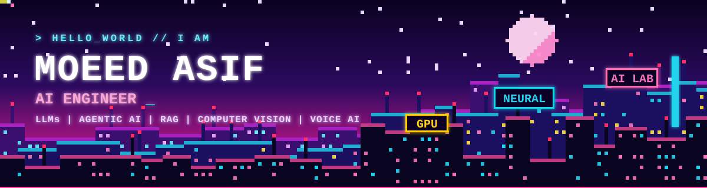

<!-- Banner -->

  

<!-- Animated tagline -->

  

 

  
  
  
  

---

## 👨‍💻 About Me

🎓 **BS Computer Science**, FAST NUCES  
💼 **2+ years** of experience as an **AI Engineer**

I design and build AI/ML models and applied AI systems across domains such as **healthcare** and **industrial automation**, and I'm always exploring new ones. My core stack is **Python, TensorFlow and PyTorch**, with hands-on work in **generative AI (LLMs), agentic systems and computer vision**. I have a track record of delivering **scalable AI systems, voice assistants and automated solutions**, backed by **cloud platforms (AWS, GCP)** and **MLOps** practices.

---

## 🚀 What I'm Up To

| | |
|---|---|
| 🔭 **Working on** | Agentic AI, LLMs, RAG systems and Computer Vision |
| 🌱 **Learning** | Voice AI assistants |
| 💬 **Ask me about** | Python, Generative AI, Agentic AI and Voice AI systems |
| 📫 **Reach me at** | [asifmoeed2@gmail.com](mailto:asifmoeed2@gmail.com) |

---

## 🛠️ Tech Stack

### 🤖 AI / ML

  
  

### ☁️ Cloud & DevOps

  

### 🌐 Backend & APIs

  
  

### 🗄️ Databases

  

### 💻 Languages & Other Tools

  

---

## 📊 GitHub Stats

  
  

  

### 📈 Contribution Activity

  

### 🏆 Trophies

  

---

## 🤝 Let's Connect

I'm always open to conversations about **AI engineering, LLM and agentic systems, and collaboration opportunities**. Feel free to reach out!

  
  

<!-- Footer -->

  

